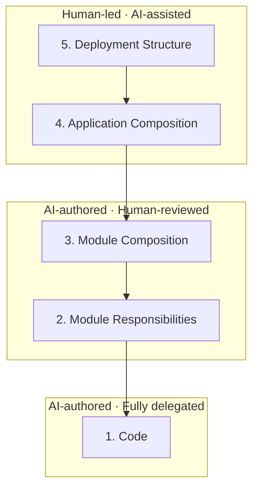

# Philosophy

> 이 문서의 "저"는 Architecture Companion의 소유자이자 메인테이너를 가리킵니다.

코드 생성은 AI가 담당하더라도, 그 책임은 여전히 사람에게 남습니다. 구현이 현실 세계의 요구사항을 충족하는지, 제품과 서비스가 안정적으로 동작하는지 등. 지속 가능하고 사용자에게 가치 있는 소프트웨어를 만들고 유지하는 데 필요한 이해와 판단은 모두 사람의 책임입니다. 병목은 바로 이 지점에서 발생합니다.

병목이 생기는 이유는 두 가지입니다.

1. 사람이 직접 코드를 작성하지 않으면서, 코드를 쓰며 자연스럽게 이해하던 과정이 사라집니다.
2. 코드 생성 속도는 빨라졌지만, 사람의 인지 능력과 물리적인 처리 속도는 이를 따라가지 못합니다.

모든 것을 검증할 필요는 없다고 생각합니다. AI에게 일을 맡기는 것은, 다른 엔지니어의 코드를 리뷰하는 일보다는 다른 직무의 동료에게 일을 위임하는 일에 가깝습니다. 예를 들어 비엔지니어인 CEO는 엔지니어의 상사라는 이유만으로 코드를 직접 확인하지는 않습니다.

AI에게 작업을 위임할 때도 마찬가지입니다. 엔지니어의 역할을 더 작게 나누고, 사람이 무엇을 검토하고 무엇을 검토하지 않을지 범위를 다시 정의하는 것은 효과적입니다. 다만 여전히 사람이 검토해야 하는 지점이 남아 있다면, 그 방법 또한 달라져야 한다고 생각했습니다. 제가 생각하는 사람과 AI의 엔지니어링 역할 분담은 다음과 같습니다.

사람의 인지 능력에는 한계가 있으므로, 아주 길고 나쁜 코드를 분석하고 이해하는 일에는 AI가 더 강합니다. 하지만 LLM의 동작 원리는 기본적으로 확률 게임이므로, 좋은 코드와 나쁜 코드를 판단하는 능력은 사람의 수준에 미치지 못합니다. LLM은 그저 가까운 곳에 있는 패턴을 따를 확률이 더 높을 뿐입니다. 서로 다른 이유지만, 결국 AI도 사람과 마찬가지로 좋은 코드베이스에서 더 잘 동작합니다. 규칙 없이 나쁜 코드가 방치된 brownfield에서 좋은 코드가 나오기 어려운 것은 당연하며, 아무것도 없는 greenfield에서보다 직관적인 규칙과 깨끗한 코드가 유지되는 brownfield에서 더 나은 코드를 작성할 수 있습니다.

이것이 제가 Module Composition과 Module Responsibilities에서, 매번은 아니지만 주기적인 사람의 검토가 필요하다고 생각하는 이유입니다. AI Slop은 greenfield를 쉽게 망치고, 나쁜 brownfield를 더욱 악화시킵니다. 이런 상황이 반복되면 사람의 개입이 필요한 문제를 해결하기 어려워집니다. 나쁜 코드가 만든 제약에 좌우되어, 어떤 기능을 만들지에 관한 사람의 판단도 흐려지기 쉽습니다. Architecture Companion은 쏟아지는 AI 코드를 필요한 만큼만 다루어 이 문제를 해결하는 것을 목표로 설계되었습니다. 실제로 저는 Code 계층을 검토하지 않습니다 (일종의 실험입니다). 대신 Module Responsibilities를 이해하고 Module Composition을 조정하기 위해 코드·파일·모듈을 재배치하면서, 변경의 영향 범위를 좁히고 적절한 설계를 유지하는 데 집중하며, 이때 우연히 Code도 잠깐 볼 뿐입니다. 그리고 구현 속도를 위해 매번 꼼꼼히 검토하지 않고, 일부는 개선 작업으로 미뤄두기도 합니다.

이 문제를 해결하기 위해 제가 떠올린 가장 좋은 수단은 다이어그램이었습니다. 다이어그램은 주로 이해를 위한 도구입니다. 사람들 사이의 협업에서 쓰이며, 지금은 AI의 응답을 이해하는 데에도 쓰입니다. 그러나 그림 하나에 모든 정보를 담으면 복잡해지고, 단순화하면 무용지물이 됩니다. 그래서 기존 다이어그램 도구는 적절한 추상화 수준에서 이해를 돕는 데 머뭅니다. 물론 그 목적에 충실하여 큰 도움을 주지만, 대규모 스파게티 코드를 정리하는 작업에는 직접적인 도움을 주지 못합니다.

범용 다이어그램 렌더러로 단순한 그림을 표현하는 대신, 사용자의 요구사항과 목적에 맞는 기능과 자동 배치를 따로 만드는 것도 같은 이유에서입니다. 모든 문제를 해결하는 다이어그램은 존재한 적이 없었고, 저는 모든 사람의 문제를 반만 해결하기보다, 특정한 문제를 겪는 사람들의 고충을 정확히 해결하는 편이 낫다고 판단했습니다 (이는 접근의 옳고 그름을 뜻하지 않습니다). 용도에 맞는 다이어그램을 하나씩 고민하고 구현하는 일은 고되지만, AI의 도움이 있기에 더 빠르게 도달할 수 있다고 믿습니다.

다만 Architecture Companion은 Module Composition과 Module Responsibilities를 비롯한 설계와 구조를 표현하는 데 집중할 뿐, Code 계층의 코드 한 줄 한 줄을 그림으로 옮기는 데에는 관심을 두지 않습니다. 그 수준에서는 코드를 직접 읽거나 에이전트에게 물어보는 쪽이 대체로 더 효율적이고, 아티팩트에 모두 기록하면 작은 변경에도 갱신이 필요해 관리 비용이 폭증하기 때문입니다. 그림은 어디를 볼지 알려 주고, 그 안의 내용은 코드와 에이전트가 답합니다. Architecture Companion은 이러한 위임과 역할 분담 위에서 동작합니다.

이 기본 철학을 바탕으로 의사결정하고, 기능을 기획하고, 코드를 구현해 주세요. 저장소에 기여하는 모든 사람과 에이전트에게 드리는 요청입니다.
