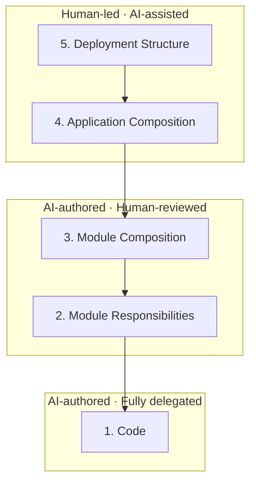

# Philosophy

> In this document, "I" refers to the owner and maintainer of Architecture Companion.

Even when AI generates the code, people remain responsible for it. That includes ensuring that implementations meet real-world requirements and that products and services run reliably. The understanding and judgment needed to build and maintain sustainable software that delivers value to users remain entirely human responsibilities. This is where the bottleneck lies.

There are two reasons for this bottleneck:

1. When people no longer write code themselves, they lose a natural way of building understanding.
2. Code generation has become faster, but people cannot match that speed, given the limits of human cognition and how quickly they can physically work.

I do not think everything needs to be verified. Delegating work to AI is closer to delegating work to a colleague in another role than to reviewing another engineer's code. A CEO who is not an engineer, for example, does not inspect code merely because they manage the engineers.

The same applies when delegating work to AI. Breaking the engineer's role into smaller parts and redefining what people will and will not review is effective. But wherever human review is still needed, I believe the way we review must change as well. Here is how I see the division of engineering roles between people and AI:

Human cognitive capacity is limited, so AI is better at analyzing and understanding very long, poorly written code. But LLMs fundamentally operate on probabilities, so they are not as good as people at judging whether code is good or bad. LLMs are simply more likely to follow the patterns close at hand. For different reasons, AI and people both work better in a good codebase. It is no surprise that good code is hard to produce in a brownfield where bad code is left unchecked and there are no rules. A brownfield that maintains intuitive rules and clean code can yield better code than an empty greenfield.

This is why I believe Module Composition and Module Responsibilities need periodic human review, though not on every change. AI Slop can easily ruin a greenfield and make a bad brownfield even worse. If this keeps happening, problems that require human intervention become harder to solve. The constraints imposed by bad code can also cloud people's judgment about which features to build. Architecture Companion was designed to address this problem by helping people work with only as much of the flood of AI-generated code as necessary. In practice, I do not review the Code layer (this is an experiment of sorts). Instead, I rearrange code, files, and modules to understand Module Responsibilities and adjust Module Composition, focusing on containing the impact of changes and maintaining an appropriate design. I only look briefly at Code when I happen to encounter it in the process. To keep implementation moving quickly, I do not review everything thoroughly every time, and I defer some improvements until later.

Diagrams were the best tool I could think of for addressing this problem. Their primary purpose is to help people understand. People use them to collaborate, and now they also use them to understand AI responses.

However, putting all the information into a single diagram makes it too complex, while simplifying it makes it useless. Existing diagramming tools therefore stop at helping people understand at an appropriate level of abstraction. They are valuable precisely because they serve that purpose well, but they do not directly help with untangling large spaghetti codebases.

This is also why I build features and automatic layouts tailored to users' requirements and goals, rather than using a general-purpose diagram renderer to draw simple pictures. No diagram has ever solved every problem. I decided it was better to address the pain points of people facing a specific problem precisely than to solve everyone's problems halfway (this is not a judgment about whether an approach is right or wrong). Designing and implementing each diagram for its intended use is demanding, but I believe AI can help me get there faster.

Still, Architecture Companion focuses on representing design and structure, including Module Composition and Module Responsibilities. It is not concerned with turning every line of code in the Code layer into a diagram. At that level, reading the code directly or asking an agent is generally more efficient. Recording every detail in artifacts would also require updates for even small changes, causing maintenance costs to grow dramatically. Diagrams tell you where to look; the code and agents answer questions about what is inside. Architecture Companion relies on this delegation and division of roles.

Also, Architecture Companion is not a knowledge graph. The diagrams and artifacts it produces exist to help people understand code and judge the design, not to serve as a knowledge base that agents query. If you need such a tool, use something like Graphify. Architecture Companion does not aim to take its place.

Let this philosophy guide your decisions, feature planning, and code implementation. This is my request to every person and agent contributing to the repository.
